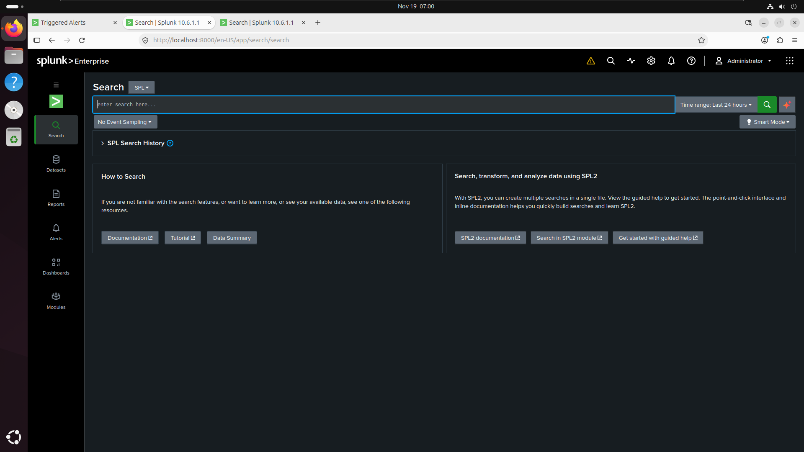
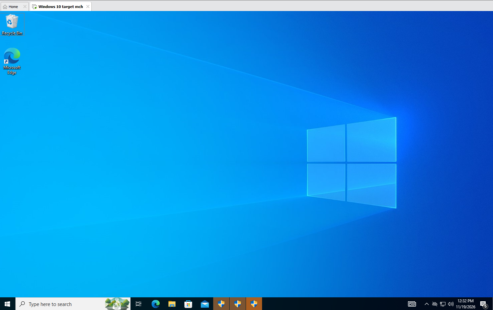
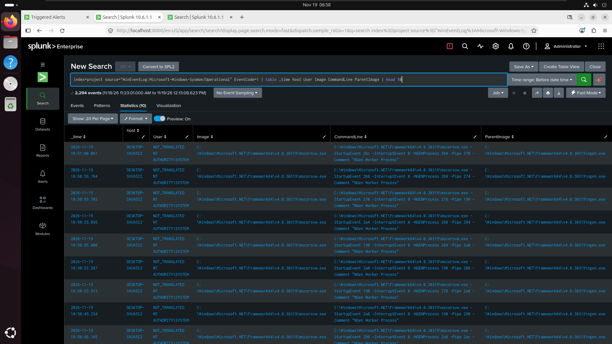

# Lab setup

Three virtual machines running in VMware, on the same network.

| Machine | OS | Hostname / IP | What it does |
|---|---|---|---|
| Target | Windows 10 (10.0.19041.2913) | DESKTOP-SVUA5I2 | Gets attacked, generates the logs |
| Attacker | Kali Linux | 192.168.0.108 | Runs the brute force |
| SIEM | Ubuntu | localhost:8000 (Splunk web) | Splunk Enterprise 10.6.1.1 |

Local accounts on the target that show up in the logs: `SOC_Analyst` (the account I used to run the PowerShell tests) and `SocLab` (the account the brute force went after).

## What gets collected

| Source | Event IDs I used | Why |
|---|---|---|
| Windows Security log | 4625 | Failed logons. Shows logon type, source address, workstation name and failure code |
| Sysmon / Operational | 1 | Process creation with the full command line, parent process, user and hashes |

Everything lands in one Splunk index called `project`.

## Screenshots

**Splunk on the Ubuntu VM**

**Windows 10 target**

**Kali attacker**

**Checking that Sysmon is sending data**

I ran a quick search for Sysmon Event ID 1 and got 2,294 events. The first ones at the top were all `mscorsvw.exe` started by `ngen.exe` as SYSTEM. That is the .NET runtime compiling images in the background, which is normal. It was my first hint that I would need to filter the process events carefully.

## Time zones

Splunk in my lab displays UTC. The Windows event text and the Triggered Alerts page use IST (UTC+5:30). So the PowerShell event is `06:45:05` in a Splunk table and `12:15:05 PM` in the raw event. It is the same event. In the write-ups I use IST unless I say otherwise.
