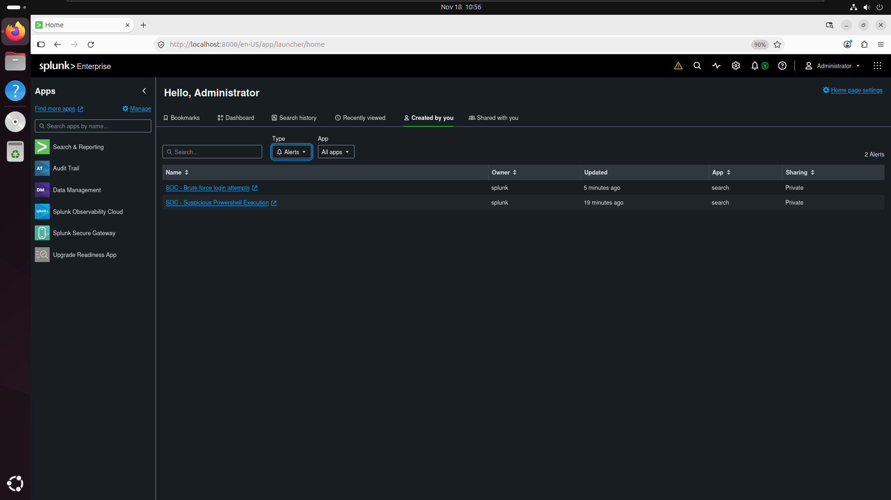
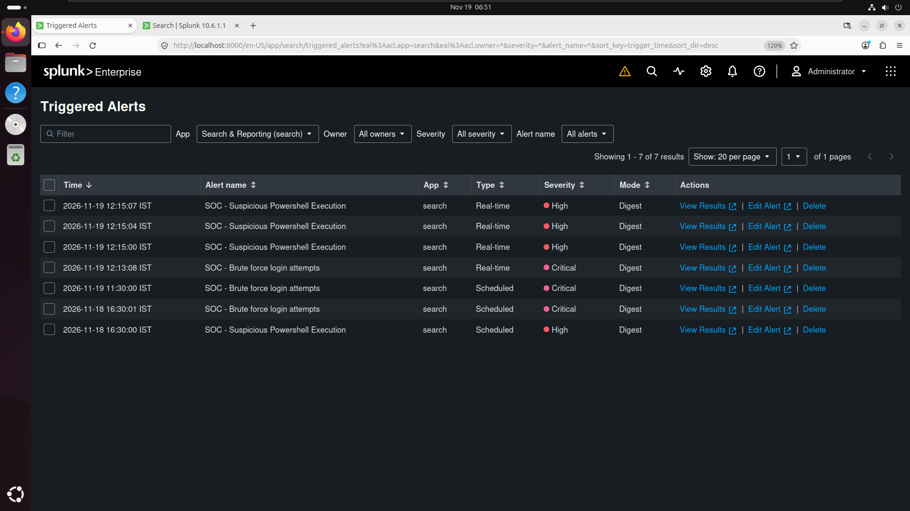
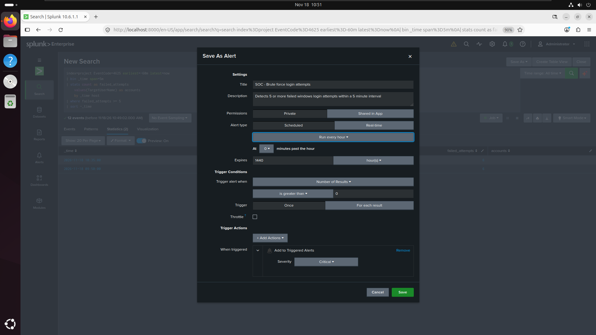
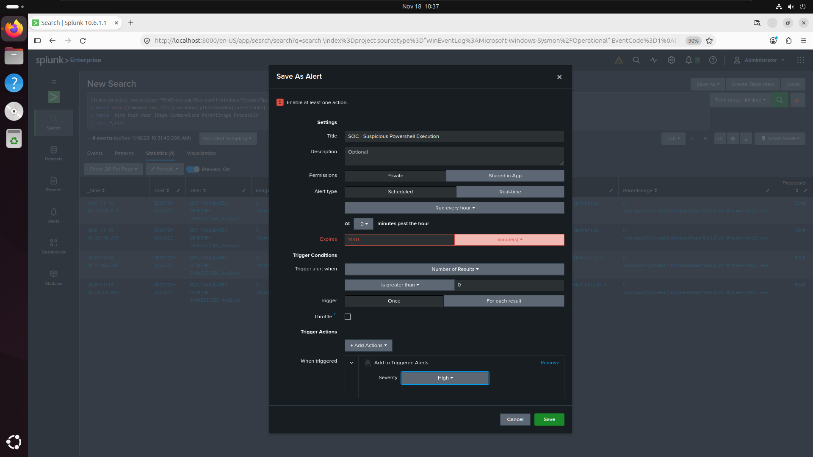

# Alert configuration

## The two alerts

I saved two searches as Splunk alerts. Both write to Triggered Alerts.

| Alert | Severity | Type | Trigger | Search |
|---|---|---|---|---|
| SOC - Brute force login attempts | Critical | Real-time | Results greater than 0, for each result | Query in [brute-force-investigation.md](../03-investigation/brute-force-investigation.md) |
| SOC - Suspicious Powershell Execution | High | Real-time | Results greater than 0, for each result | Query in [powershell-investigation.md](../03-investigation/powershell-investigation.md) |

The description I gave the brute force alert: "Detects 5 or more failed windows login attempts within a 5 minute interval".

### Triggered alerts

Seven entries in total:

| Time (IST) | Alert | Type | Severity |
|---|---|---|---|
| 2026-11-18 16:30:00 | Suspicious Powershell Execution | Scheduled | High |
| 2026-11-18 16:30:01 | Brute force login attempts | Scheduled | Critical |
| 2026-11-19 11:30:00 | Brute force login attempts | Scheduled | Critical |
| 2026-11-19 12:13:08 | Brute force login attempts | Real-time | Critical |
| 2026-11-19 12:15:00 | Suspicious Powershell Execution | Real-time | High |
| 2026-11-19 12:15:04 | Suspicious Powershell Execution | Real-time | High |
| 2026-11-19 12:15:07 | Suspicious Powershell Execution | Real-time | High |

The Nov 18 entries came from my local test data. The real-time entries on Nov 19 are the Kali attack (12:13) and the hidden PowerShell test (12:15).

The PowerShell alert is set to trigger "for each result", so one run gave three entries in 7 seconds. In a real SOC I would turn on throttling or use "Once" to avoid flooding the queue.

## How I created them

1. Run the detection search in Search & Reporting and check it returns what I expect.
2. Save As, then Alert.
3. Fill in the settings:

| Setting | Brute force | PowerShell |
|---|---|---|
| Title | SOC - Brute force login attempts | SOC - Suspicious Powershell Execution |
| Description | Detects 5 or more failed windows login attempts within a 5 minute interval | (left empty) |
| Alert type | Real-time (I also had it as a scheduled hourly alert earlier) | Real-time |
| Trigger alert when | Number of results is greater than 0 | Number of results is greater than 0 |
| Trigger | For each result | For each result |
| Throttle | Off | Off |
| Trigger action | Add to Triggered Alerts | Add to Triggered Alerts |
| Severity | Critical | High |

4. Save, then check the Alerts list and, after a test, the Triggered Alerts page.

