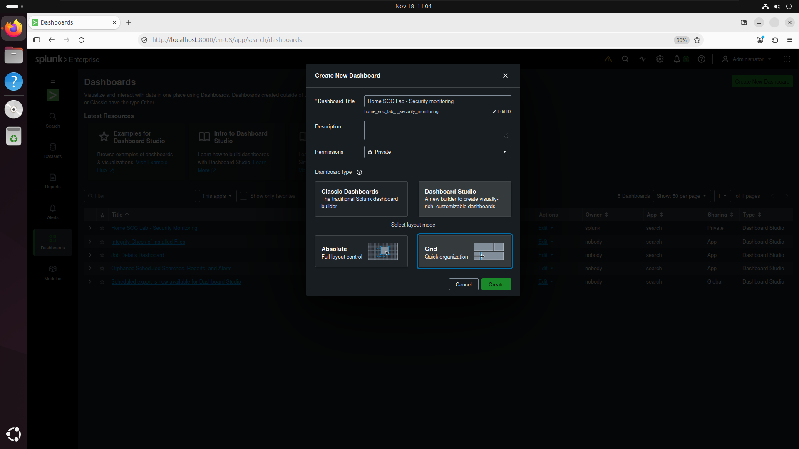
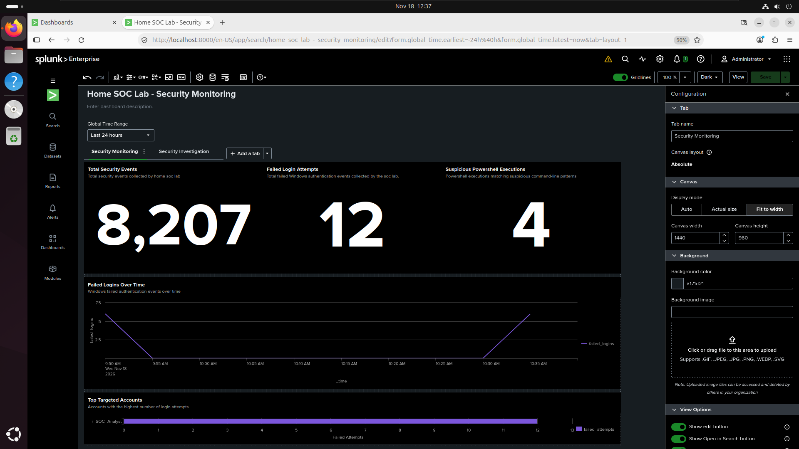
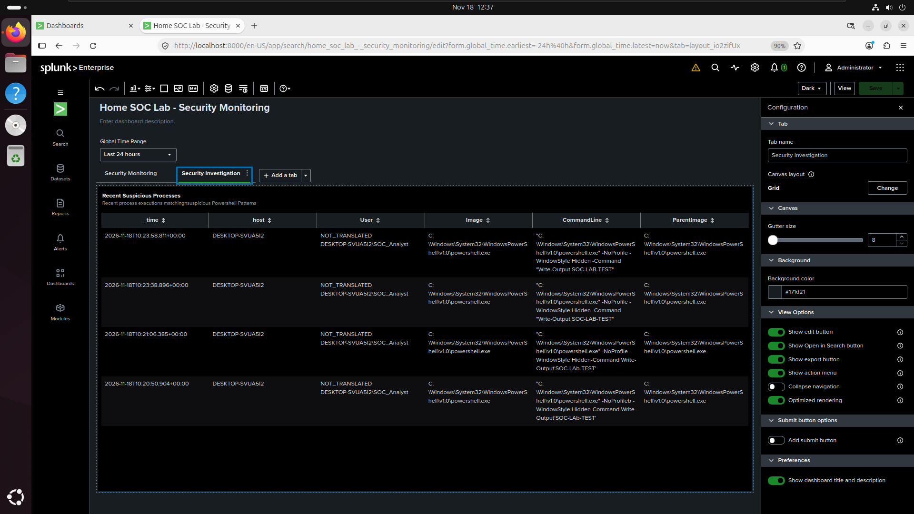

# Dashboard: Home SOC Lab - Security Monitoring

Built with Dashboard Studio, dark theme, global time range of the last 24 hours. Two tabs.

### Tab 1: Security Monitoring

| Panel | What it shows | Value when I took the screenshot |
|---|---|---|
| Total Security Events | All events collected by the lab | 8,207 |
| Failed Login Attempts | Windows failed authentication events | 12 |
| Suspicious Powershell Executions | Rule matches on command line | 4 |
| Failed Logins Over Time | Line chart of 4625 over time | Two bursts, around 09:50 and 10:35 UTC |
| Top Targeted Accounts | Bar chart of failed attempts by account | SOC_Analyst, 12 |

These numbers are from Nov 18, before the Kali attack, so the 12 failed logins are the local test data.

### Tab 2: Security Investigation

One table, "Recent Suspicious Processes": time, host, user, image, command line and parent image for each PowerShell match. It is meant to be the page an analyst opens after the alert fires to see the command line straight away.

## Ideas to improve it

- Add a panel for failed logons by source IP. That would have shown the Kali address straight away.
- Add a panel for successful logons (4624) next to the failures.
- Throttle the alerts by host so repeated hits are grouped.
