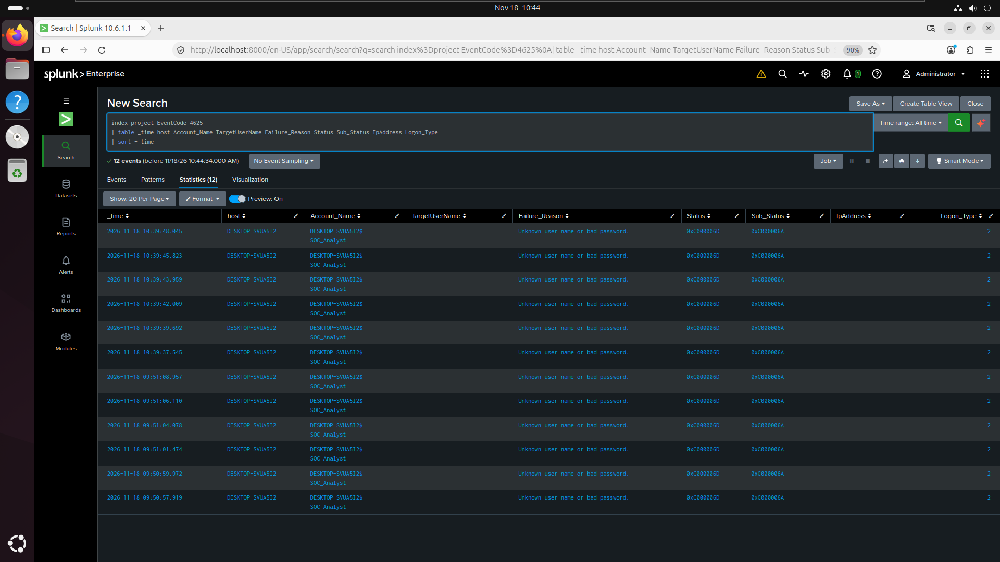
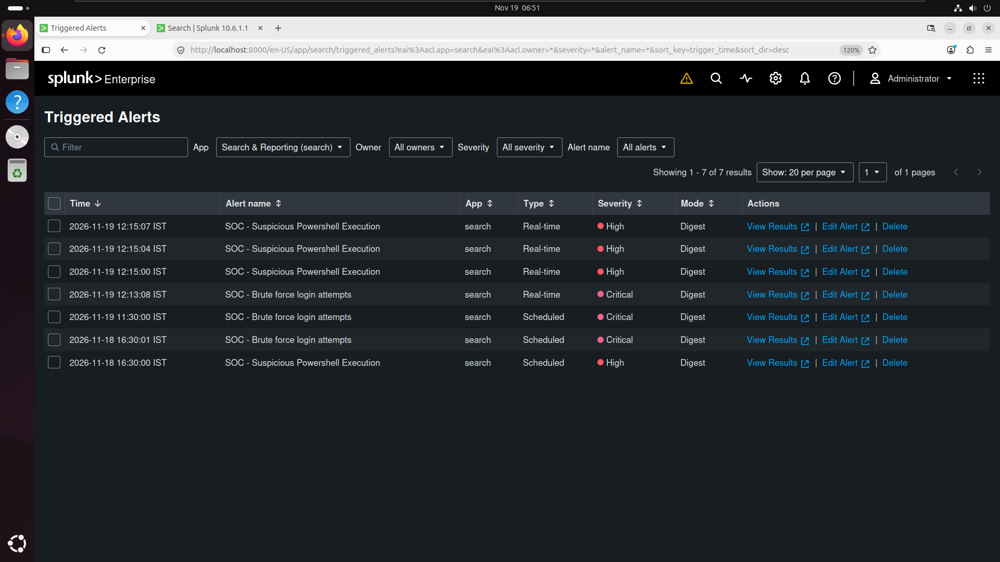
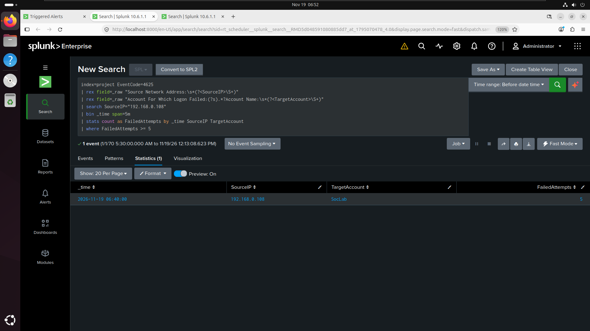
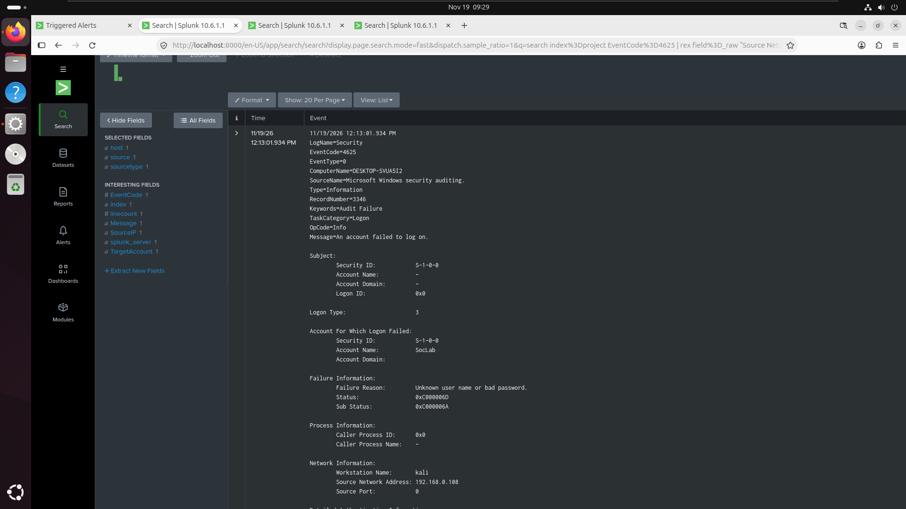
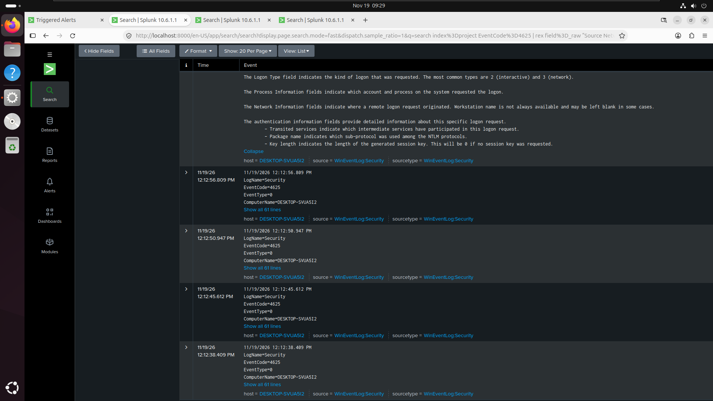
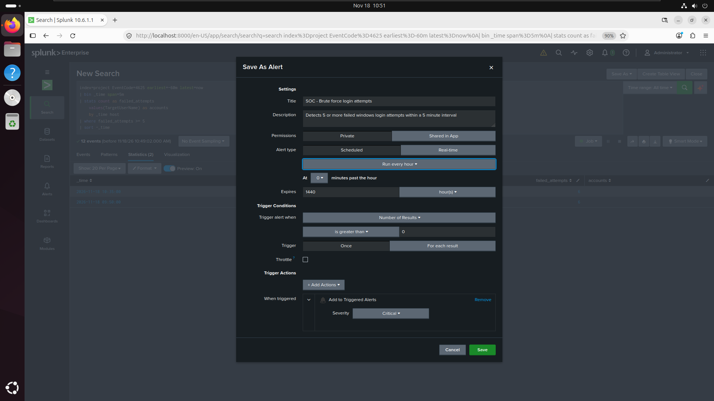

# Investigation: Brute force login attempts

| | |
|---|---|
| Alert | SOC - Brute force login attempts |
| Severity | Critical |
| Triggered | 2026-11-19 12:13:08 IST (real-time) |
| Target host | DESKTOP-SVUA5I2 |
| Source | 192.168.0.108 (workstation name `kali`) |
| Targeted account | SocLab |
| MITRE | T1110.001 Brute Force: Password Guessing (Credential Access) |
| Verdict | True positive. This was my own simulated attack |

## 1. Building the detection (Nov 18)

I started by generating failed logins on the Windows VM and looking at what Windows records. The first search was just every 4625 event:

```
index=project EventCode=4625
| table _time host Account_Name TargetUserName Failure_Reason Status Sub_Status IpAddress Logon_Type
| sort -_time
```



12 events in two bursts of 6 (09:50:57 to 09:51:08 UTC and 10:39:37 to 10:39:48 UTC). Things I noticed:

- Logon type is `2` (interactive) and `IpAddress` is empty. These were typed at the machine itself, so they were my test data and not a network attack.
- `TargetUserName` and `IpAddress` are empty even though the data is clearly there. The field extraction was not picking them up. I had to deal with this later.
- Status `0xC000006D` and sub status `0xC000006A` on every row.

From this I wrote the first alert: count 4625 events per host in 5 minute buckets, alert at 5 or more.

```
index=project EventCode=4625 earliest=-60m latest=now
| bin _time span=5m
| stats count as failed_attempts
        values(TargetUserName) as accounts
        by _time host
| where failed_attempts >= 5
| sort -_time
```

Both bursts came back with a count of 6, so the rule worked on the test data.

## 2. The attack from Kali (Nov 19)

Next I attacked from Kali against the `SocLab` account. At 12:13:08 IST the real-time alert showed up in Triggered Alerts as Critical.



## 3. Triage

First question: who, from where, against what, and how many?

Because the extracted fields were empty, I used `rex` on the raw event to pull out the source IP and the target account:

```
index=project EventCode=4625
| rex field=_raw "Source Network Address:\s*(?<SourceIP>\S+)"
| rex field=_raw "Account For Which Logon Failed:(?s).*?Account Name:\s*(?<TargetAccount>\S+)"
| search SourceIP="192.168.0.108"
| bin _time span=5m
| stats count as FailedAttempts by _time SourceIP TargetAccount
| where FailedAttempts >= 5
```

Result: one row, source `192.168.0.108`, target `SocLab`, 5 failed attempts in the 12:10 to 12:15 bucket.



## 4. Looking at the raw event

I opened the newest 4625 (12:13:01.934 PM) to read it properly.



| Field | Value | What it means |
|---|---|---|
| Logon Type | 3 | Network logon, not at the keyboard |
| Account For Which Logon Failed | SocLab | The account being guessed |
| Subject Account Name | - | Nobody was authenticated yet, normal for a failed network logon |
| Failure Reason | Unknown user name or bad password | |
| Status | 0xC000006D | Logon failed |
| Sub Status | 0xC000006A | Wrong password for a user name that exists |
| Workstation Name | kali | Name sent by the client |
| Source Network Address | 192.168.0.108 | Where it came from |
| Source Port | 0 | |

The sub status is the useful one. `0xC000006A` says the user name was right and the password was wrong. If the account did not exist it would be `0xC0000064`. So the source knew a valid account name.

## 5. Timeline

All times IST, from the Windows event text.

| Time | Event |
|---|---|
| 12:12:38.409 | 4625, SocLab, from 192.168.0.108 |
| 12:12:45.612 | 4625 |
| 12:12:50.947 | 4625 |
| 12:12:56.809 | 4625 |
| 12:13:01.934 | 4625 (fifth failure, threshold reached) |
| 12:13:08 | Splunk alert triggered, Critical |



Five failures in about 23 seconds, spaced 5 to 7 seconds apart. That is a slow pace. Slow guessing like this is the kind that can stay under a loose lockout policy.

## 6. Findings

- A single source (192.168.0.108) made repeated network logon attempts against a single account (SocLab).
- The failures match password guessing, so the technique is T1110.001. It is not password spraying (T1110.003) because only one account was targeted.
- The source knew a valid user name.
- I only looked at 4625 failures. I did not search for a 4624 (success) from the same IP, so I cannot say from this data whether any guess worked. In a real case this would be the first thing I check.

## 7. What I would do in a real environment

1. Check for a successful logon (4624) for `SocLab` from 192.168.0.108 after 12:12:38. If found, treat the account as compromised and reset it.
2. Look at what else 192.168.0.108 touched in the same period.
3. Block the source at the firewall if it is not a known host.
4. Set an account lockout threshold and, for remote access, require MFA.
5. Confirm with the account owner that nothing legitimate (a service with an old password, for instance) is failing.

## 8. Detection notes

- The alert is real-time, severity Critical, trigger condition "number of results is greater than 0", action "Add to Triggered Alerts". Config screenshot below.
- The scheduled version of the same alert also fired on Nov 18 (16:30 IST) and Nov 19 (11:30 IST). They show at half past the hour, most likely because the schedule runs on the hour in UTC and IST is 5:30 ahead.
- Weak point: `bin _time span=5m` uses fixed buckets. Five failures that straddle a bucket edge could be counted as 3 and 2 and not alert. A sliding window would fix it.
- False positives I would expect: someone forgetting a password, or a service account with an expired password.


