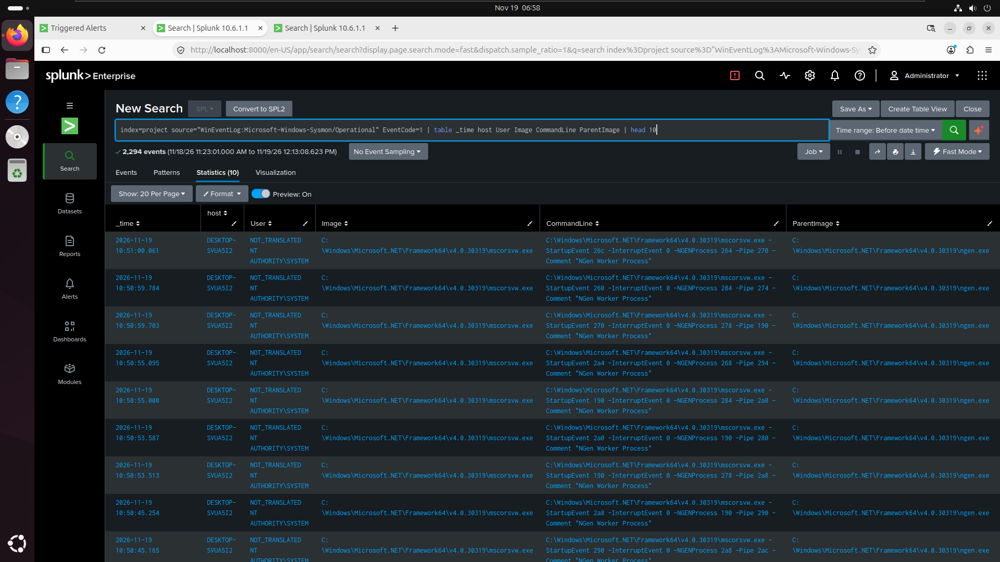
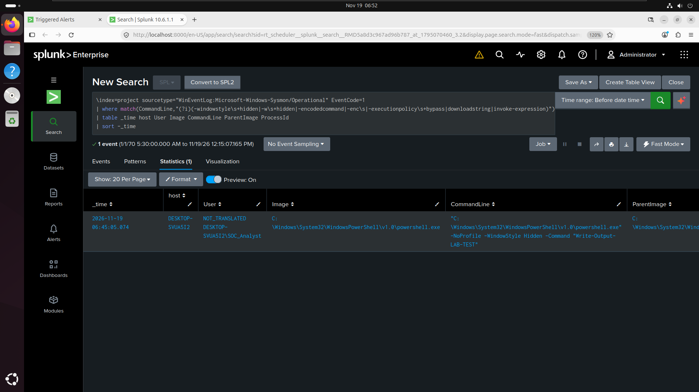
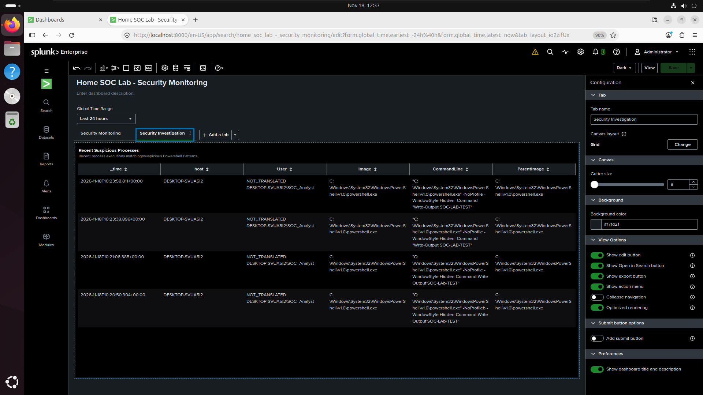
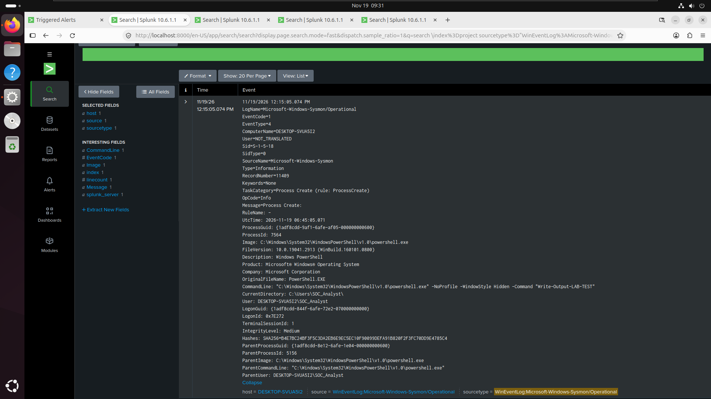
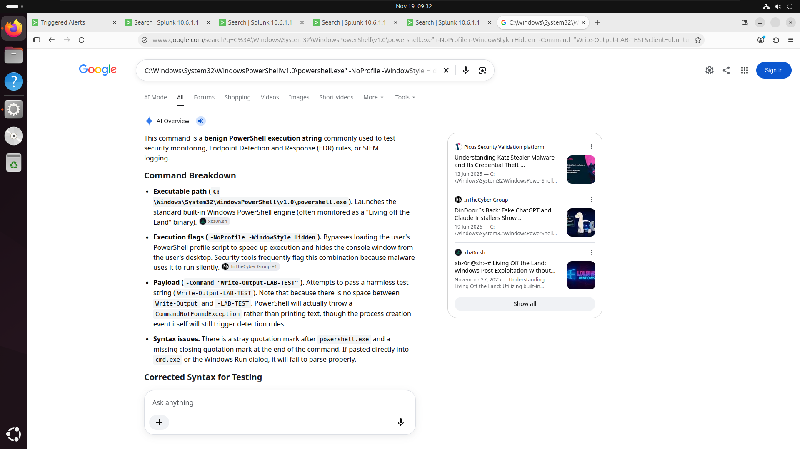
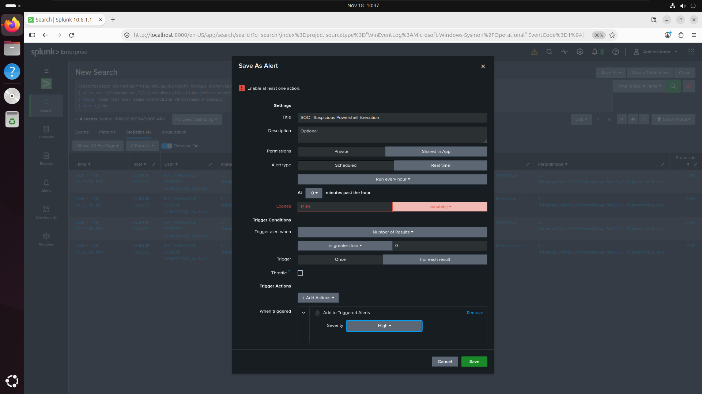

# Investigation: Suspicious PowerShell execution

| | |
|---|---|
| Alert | SOC - Suspicious Powershell Execution |
| Severity | High |
| Triggered | 2026-11-19 12:15:00, 12:15:04 and 12:15:07 IST (real-time) |
| Host | DESKTOP-SVUA5I2 |
| User | DESKTOP-SVUA5I2\SOC_Analyst |
| MITRE | T1059.001 PowerShell (Execution), T1564.003 Hidden Window (Defense Evasion) |
| Verdict | True positive. This was my own test command |

## 1. Why Sysmon

Windows Security logs tell you a process started, but not what its command line was unless you turn on extra auditing. Sysmon Event ID 1 records the full command line, parent process, user, integrity level and file hashes, so the detection is built on that.

The raw Sysmon data is mostly noise. In the first 10 events I pulled, every row was `mscorsvw.exe` started by `ngen.exe` as SYSTEM, which is .NET maintenance. Alerting on every new process would be pointless, so the rule filters on command line patterns.



## 2. The detection

```
index=project sourcetype="WinEventLog:Microsoft-Windows-Sysmon/Operational" EventCode=1
| where match(CommandLine,"(?i)(-windowstyle\s+hidden|-w\s+hidden|-encodedcommand|-enc\s|-executionpolicy\s+bypass|downloadstring|invoke-expression)")
| table _time host User Image CommandLine ParentImage ProcessId
| sort -_time
```

Patterns in the regex:

| Pattern | Why it matters |
|---|---|
| `-windowstyle hidden`, `-w hidden` | Hides the console window from the user |
| `-encodedcommand`, `-enc` | Base64 command, often used to hide what is being run |
| `-executionpolicy bypass` | Skips the script execution policy |
| `downloadstring` | Common in download-and-run one liners |
| `invoke-expression` | Runs a string as code |

In my lab I only tested the first one. The others are in the rule because they are well known, not because I triggered them.

Result on Nov 19: 1 event.



## 3. Earlier test runs (Nov 18)

The Security Investigation tab of my dashboard shows 4 matches from the day before. Looking at the command lines, my test commands had typos in them:

| Time (UTC) | Command line (end part) |
|---|---|
| 10:20:50 | `-NoProfileb -WindowStyle Hidden-Command Write-Output'SOC-LAb-TEST'` |
| 10:21:06 | `-NoProfile -WindowStyle Hidden-Command Write-Output'SOC-LAb-TEST'` |
| 10:23:38 | `-NoProfile -WindowStyle Hidden -Command "Wrte-Output SOC-LAB-TEST"` |
| 10:23:58 | `-NoProfile -WindowStyle Hidden -Command "Wrte-Output SOC-LAB-TEST"` |

Those commands would not have run properly, but Sysmon still logged the process creation and the rule still matched on `-WindowStyle Hidden`. That is a good property for a detection: it looks at what was attempted, not whether it worked.



## 4. Looking at the Nov 19 event

I opened the full event (12:15:05.074 IST, 06:45:05 UTC).



| Field | Value | What I took from it |
|---|---|---|
| Image | `C:\Windows\System32\WindowsPowerShell\v1.0\powershell.exe` | Correct system path |
| OriginalFileName | PowerShell.EXE | Matches the file name, so it is not a renamed binary |
| Company / Description | Microsoft Corporation / Windows PowerShell | |
| FileVersion | 10.0.19041.2913 | Same as the OS build |
| Hashes | SHA256 `B4E7BC24BF3F5C3DA2EB6E9EC5EC10F90099DEFA91B820F2F3FC70DD9E4785C4` | Could be checked against a reputation service |
| CommandLine | `... -NoProfile -WindowStyle Hidden -Command "Write-Output-LAB-TEST"` | No profile, hidden window, inline command |
| User | DESKTOP-SVUA5I2\SOC_Analyst | A normal user, not SYSTEM |
| IntegrityLevel | Medium | Not elevated |
| TerminalSessionId | 1 | Interactive desktop session, not a service |
| CurrentDirectory | `C:\Users\SOC_Analyst\` | |
| ProcessId / ParentProcessId | 7564 / 5156 | |
| ParentImage | `powershell.exe` | Started from another PowerShell window |
| ParentUser | DESKTOP-SVUA5I2\SOC_Analyst | Same user as the child |

The picture: a genuine PowerShell, run by a normal user in an interactive session, launched from another PowerShell, with flags that suppress the profile and hide the window. The hidden window is the interesting part. There is not much legitimate reason for a person sitting at the machine to hide the window.

The payload is `Write-Output-LAB-TEST`, which is my own marker string. As written it is not a real cmdlet name, so PowerShell would just throw an error. Again, the process creation was still logged.

## 5. Checking the command line online

I also pasted the command line into Google to see how it is commonly described. The result called it a benign test string often used to check security monitoring and pointed out the same kind of syntax problem. I only used this as a quick sanity check, not as evidence, since the real evidence is the Sysmon event.



## 6. Findings

- `powershell.exe` was launched with `-NoProfile -WindowStyle Hidden -Command`.
- The binary, path, company, description and version are all consistent with a genuine Windows PowerShell.
- It ran as a standard user at Medium integrity from an interactive session.
- The command content is a test marker. I wrote it, so the verdict is a true positive for detection and a benign result for impact.
- I did not look for child processes or network connections from PID 7564, because the payload is known to be harmless here.

## 7. What I would do in a real environment

1. Search Sysmon Event ID 1 for `ParentProcessId=7564` to see what the process started (something like `index=project sourcetype="WinEventLog:Microsoft-Windows-Sysmon/Operational" EventCode=1 ParentProcessId=7564 | table _time Image CommandLine`).
2. Check Sysmon Event ID 3 (network connection) for the same process to see if it reached out to anything.
3. Look at PowerShell Script Block Logging (4104) for the actual script text. I have not enabled it in this lab yet.
4. Check what started the parent PowerShell (5156) and whether the user was logged in at the time.
5. Run the file hash through a reputation service.
6. If it was an encoded command, decode the base64 before judging it.

## 8. Detection notes

- Real-time alert, severity High, trigger "number of results is greater than 0", for each result. That is why one burst of activity produced three entries in Triggered Alerts between 12:15:00 and 12:15:07.
- False positives I would expect: admin scripts and software installers that start PowerShell hidden, and monitoring agents. These would need an allow list by parent process or script path.
- Gaps: someone can write `-W Hidden` as `-win hidden`. PowerShell accepts shortened parameter names, and my regex only handles `-windowstyle` and `-w`.


