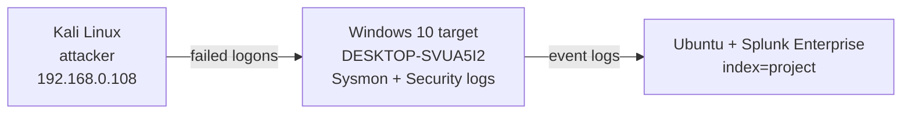
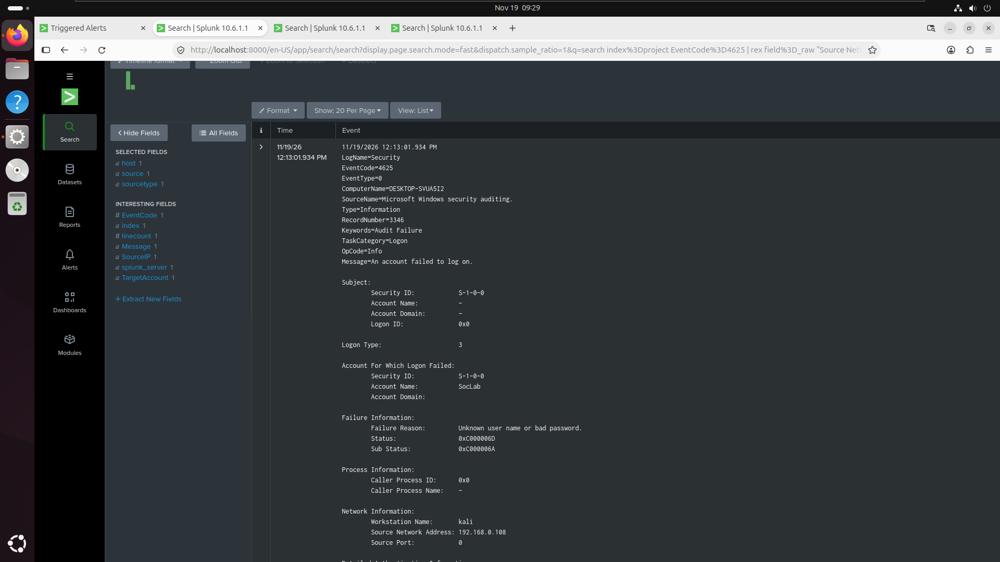
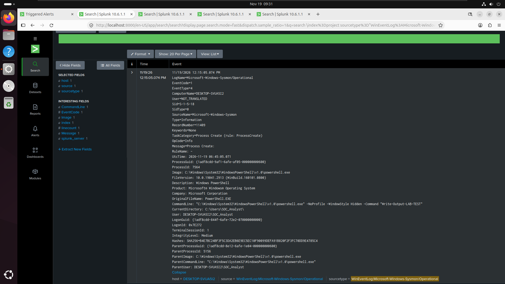
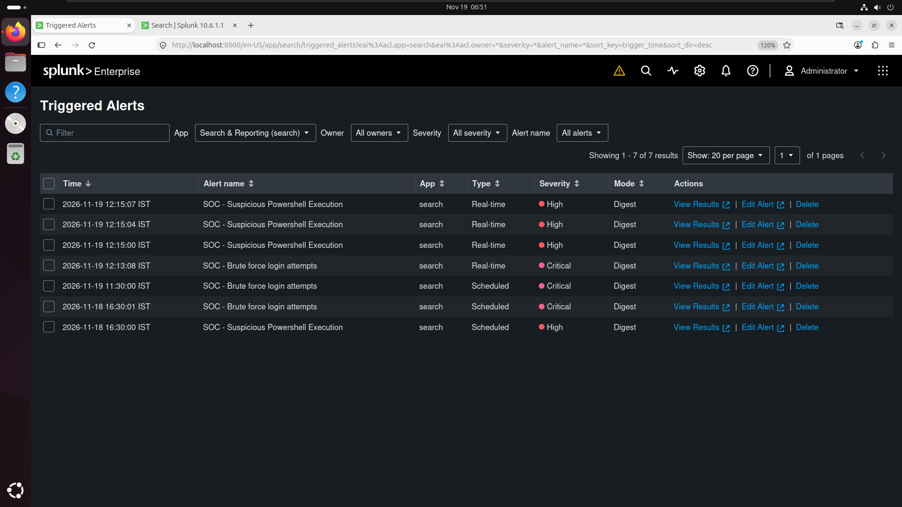
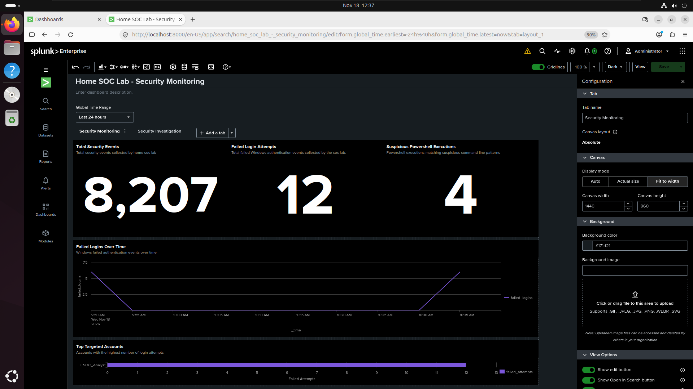

# Home SOC Lab: Brute Force and PowerShell Detection with Splunk

I built this small lab to practise what a SOC analyst does day to day: collect logs, write detections, get an alert, and then investigate it properly.

I attacked my own Windows 10 machine from Kali in two ways (repeated failed logins, and a hidden PowerShell command), collected the logs in Splunk, built alerts for both, and wrote up the investigation for each. Everything is mapped to MITRE ATT&CK.

All attacks are simulated by me, on my own VMs. No real systems were involved.

## Lab setup



| VM | Role | Notes |
|---|---|---|
| Windows 10 (build 19041) | Target | Sysmon installed, Windows Security auditing on, local user `SOC_Analyst` |
| Kali Linux | Attacker | Source of the brute force, IP 192.168.0.108 |
| Ubuntu | SIEM | Splunk Enterprise 10.6.1.1, all logs go to `index=project` |

Log sources used:
- `WinEventLog:Security`, mainly Event ID 4625 (failed logon)
- `WinEventLog:Microsoft-Windows-Sysmon/Operational`, mainly Event ID 1 (process create)

More detail in [01-lab-setup/lab-setup.md](01-lab-setup/lab-setup.md).

## Results at a glance

| | Brute force | Suspicious PowerShell |
|---|---|---|
| What I did | Repeated wrong passwords against the `SocLab` account from Kali | Ran `powershell.exe -NoProfile -WindowStyle Hidden -Command ...` |
| Log evidence | Security 4625, logon type 3, workstation `kali`, source 192.168.0.108 | Sysmon 1, full command line, parent process, user, hashes |
| Alert | SOC - Brute force login attempts (Critical) | SOC - Suspicious Powershell Execution (High) |
| Rule logic | 5 or more failures in a 5 minute window | Command line matches hidden window, encoded command, bypass, download or invoke-expression patterns |
| MITRE | T1110.001 Password Guessing | T1059.001 PowerShell, T1564.003 Hidden Window |
| Write-up | [03-investigation/brute-force-investigation.md](03-investigation/brute-force-investigation.md) | [03-investigation/powershell-investigation.md](03-investigation/powershell-investigation.md) |

## Scenario 1: Brute force

From Kali I sent repeated failed logins to the `SocLab` account on the Windows machine. Windows logged each one as Event ID 4625. The alert fired at 12:13:08 IST on Nov 19, a few seconds after the fifth failure.

What the raw event told me:
- Logon type 3, so a network logon and not someone at the keyboard
- Workstation name `kali` and source address 192.168.0.108
- Status `0xC000006D` with sub status `0xC000006A`, which is a wrong password for an account that exists
- 5 failures between 12:12:38 and 12:13:01, about one every 5 to 7 seconds



Full walkthrough: [03-investigation/brute-force-investigation.md](03-investigation/brute-force-investigation.md)

## Scenario 2: Suspicious PowerShell

Windows has no useful default log of what a PowerShell command actually said, so this one depends on Sysmon. Event ID 1 records the full command line, the parent process, the user and the file hash.

The alert caught this on Nov 19 at 12:15 IST:

```
"C:\Windows\System32\WindowsPowerShell\v1.0\powershell.exe" -NoProfile -WindowStyle Hidden -Command "Write-Output-LAB-TEST"
```

The command itself is harmless (my own test string), but the flags are the kind attackers use: skip the profile and hide the window. The binary is the real Microsoft `powershell.exe` (OriginalFileName matches, path is System32), it ran as `SOC_Analyst` at Medium integrity, and its parent was another interactive PowerShell.



Full walkthrough: [03-investigation/powershell-investigation.md](03-investigation/powershell-investigation.md)

## Alerts and dashboard

I saved both searches as Splunk alerts and built a two tab dashboard: one tab for monitoring (event counts, failed logins over time, top targeted accounts) and one for investigation (recent suspicious processes).





Details: [alert configuration](02-alerts-and-dashboard/alert-configuration.md) and [dashboard](02-alerts-and-dashboard/dashboard.md)

## MITRE ATT&CK mapping

| Tactic | Technique | What I saw |
|---|---|---|
| Credential Access (TA0006) | T1110.001 Brute Force: Password Guessing | Repeated 4625 events for one account from one source |
| Execution (TA0002) | T1059.001 Command and Scripting Interpreter: PowerShell | `powershell.exe` started with `-Command` |
| Defense Evasion (TA0005) | T1564.003 Hide Artifacts: Hidden Window | `-WindowStyle Hidden` |

Full table with the data sources and the techniques my PowerShell rule covers but I did not test: [03-investigation/mitre-mapping.md](03-investigation/mitre-mapping.md)

## Repo layout

```
Home-SOC-Lab/
├── 01-lab-setup/
│   └── lab-setup.md
├── 02-alerts-and-dashboard/
│   ├── alert-configuration.md
│   └── dashboard.md
├── 03-investigation/
│   ├── brute-force-investigation.md
│   ├── powershell-investigation.md
│   └── mitre-mapping.md
├── 04-evidence/
│   ├── 01-lab-setup/
│   ├── 02-brute-force/
│   ├── 03-powershell/
│   └── 04-alerts-and-dashboard/
└── README.md
```

## What I learned

- Fields do not always extract the way the documentation says. My `TargetUserName` and `IpAddress` were empty for 4625 events, so I pulled the source IP and account out of the raw event with `rex`.
- Sysmon is noisy. The first events I looked at were all .NET background processes, so a rule that looks for "new process" would be useless. Matching on the command line works much better.
- A detection should not depend on the attacker succeeding. Some of my early PowerShell test commands had typos, so they would have failed, but Sysmon still logged the process start and the rule still caught it.
- Time zones are confusing. Splunk showed UTC, the Windows events showed IST (UTC+5:30). Cross checking timestamps across the two taught me to always write down the zone.

## Limitations and what I would do next

- It is one attacker and one target. Real environments have a lot more noise, so thresholds like "5 in 5 minutes" would need tuning.
- The `bin _time span=5m` approach can split a burst across two buckets, so an attack could slip under the threshold. A sliding window (`streamstats` or `transaction`) would be better.
- The brute force rule only counts failures. I would add a check for a successful logon (4624) from the same IP right after, since that is the case that really matters.
- PowerShell: turn on Script Block Logging (4104) so I can see what the script actually did, and add Sysmon network events to see connections made by the process.
- Write the same rules in Sigma format.

## Tools

Splunk Enterprise, Sysmon, Windows 10, Kali Linux, Ubuntu, VMware, MITRE ATT&CK

---

Nikhil · [GitHub](https://github.com/Nikhil-cce)
